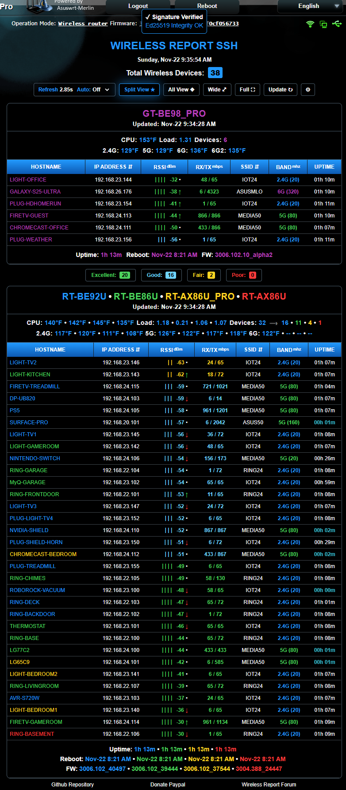
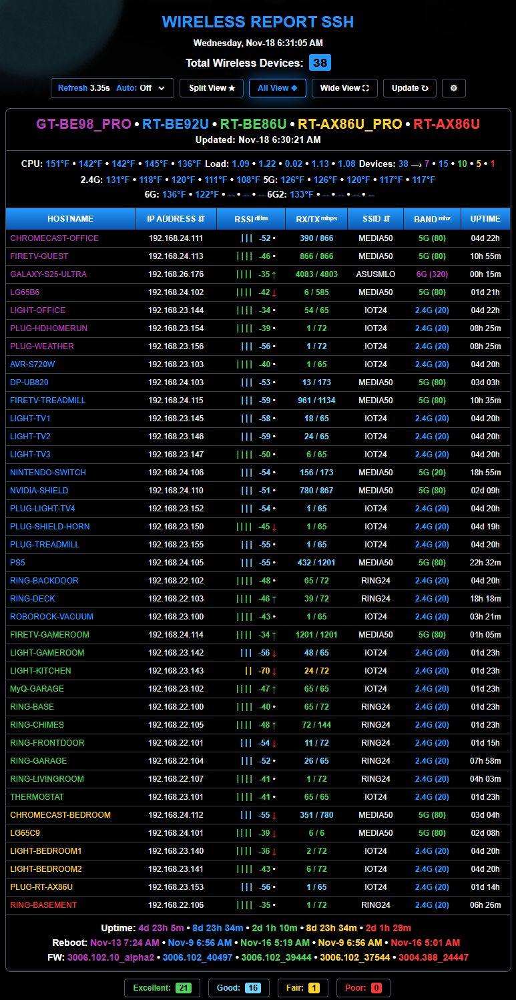

$\color{blue}{\Large\text{Wireless Report SSH}}$<br>
**Developer:** JB_1366<br><br>

$\color{blue}{\text{Install:}}$
```
curl -sfL https://raw.githubusercontent.com/JB1366/WirelessReportSSH/main/wirelessreport-ssh.sh \
-o /tmp/wirelessreport-ssh.sh && sh /tmp/wirelessreport-ssh.sh install
```
$\color{blue}{\text{Release public key:}}$
```
-----BEGIN PUBLIC KEY-----
MCowBQYDK2VwAyEAu5/h3RJDIzXY/QuN5iFsFbZOe2og/Raj5Z+ntbqBVbs=
-----END PUBLIC KEY-----
```
$\color{blue}{\text{SHA-256 Fingerprint:}}$
```
3d276905ef0d6ed18f14fc8ad124ea3a44bb5089b28d1ea337de20f8d6f68002
```
\
\

\
\

